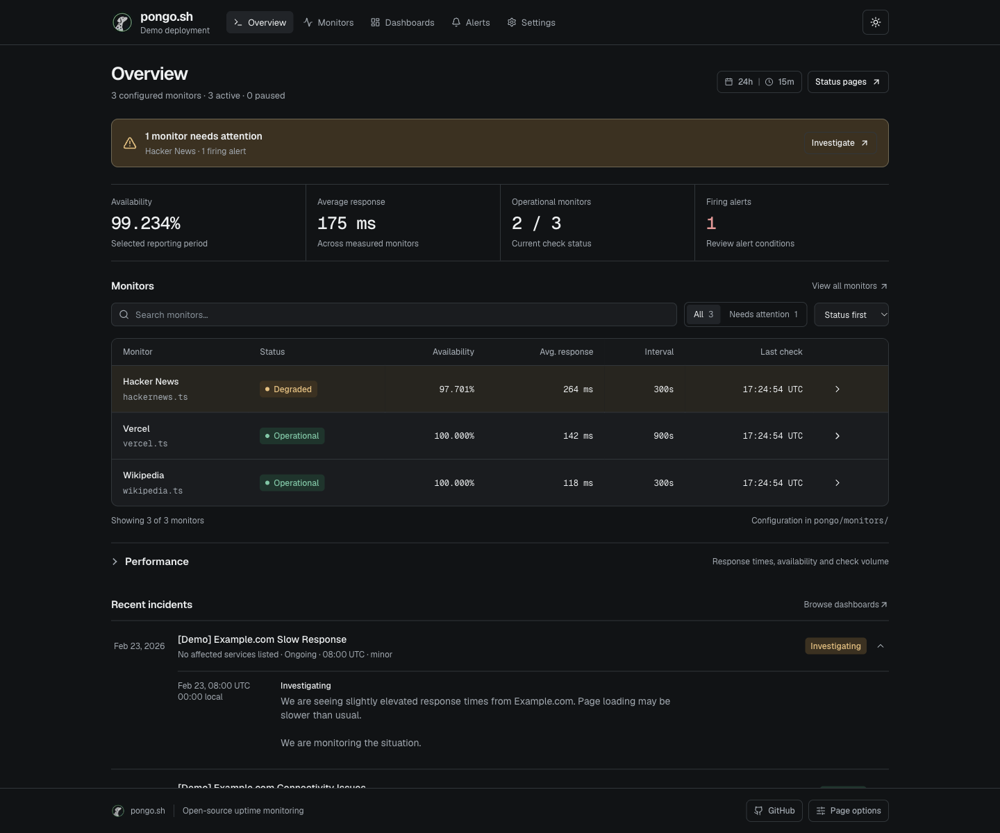

# Pongo Monitoring

Pongo is a self-hosted uptime monitor and status page. Its scheduler checks services and stores results. The operator dashboard shows check history, latency, and alerts, and public dashboards share service health, incidents, and availability. Monitor definitions and dashboards live in TypeScript alongside the app.

This fork adds a FOEMI delivery pipeline that tests and scans a Linux ARM64 image in GitHub Actions, publishes the scanned image to GitHub Container Registry (GHCR), and deploys it by digest to a local K3s cluster. The latest verified release is **v1.2.0**. [Release evidence](https://github.com/gitongatonny/pongo-monitoring/blob/main/docs/evidence/hosted-releases.md)



[Quick Start](#quick-start) · [Configuration](#configure-pongo) · [Deployment](#deploy-through-github-actions) · [Documentation](#documentation-and-license)

## Quick Start

Install [Bun](https://bun.sh/). This example uses local SQLite.

```bash
git clone https://github.com/gitongatonny/pongo-monitoring.git
cd pongo-monitoring
cp .env.example .env
bun install --frozen-lockfile
bun run db:sqlite:migrate
bun run dev
```

In a second terminal in the repository, run `bun run scheduler` to collect measurements. Open `http://localhost:3000` for the operator dashboard and `http://localhost:3000/shared/status` for the bundled public page. The page can show unknown availability until the scheduler records checks.

For PostgreSQL, set `DATABASE_URL` in `.env` and use `bun run db:pg:migrate`. For a local production build, run `bun run build` and `bun run start` after applying the database migrations. See the [example environment file](https://github.com/gitongatonny/pongo-monitoring/blob/main/.env.example).

## Configure Pongo

| Location | What to configure |
| --- | --- |
| `pongo/monitors/` | Service names, check intervals, and TypeScript check functions |
| `pongo/dashboards/` | Dashboard names, slugs, visibility, and monitor membership |
| `pongo/channels.ts` | Notification channels |
| `pongo/incidents/` and `pongo/announcements/` | Markdown incident reports and public updates |
| `.env` or Kubernetes Secrets | Database connection, operator access code, session secret, and scheduler secret |

The built-in example monitors Vercel, Hacker News, and Wikipedia. Replace those definitions and the dashboard membership with the services you want to track. [Monitor examples](https://github.com/gitongatonny/pongo-monitoring/tree/main/pongo/monitors)

## Deploy through GitHub Actions

1. Set up a Linux ARM64 K3s target using Docker, k3d, kubectl, GitHub CLI, and jq. Create the namespace and app Secret, start PostgreSQL, and configure GHCR access and the scoped watcher kubeconfig. The [deployment runbook](https://github.com/gitongatonny/pongo-monitoring/blob/main/docs/foemi-deployment.md) has the commands.
2. Start the watcher from the repository with `KUBECONFIG="$KUBECONFIG_DEMO" bash scripts/watch-local-deployments.sh`. Keep the target and watcher running through the release.
3. Push a branch and open a PR into `main` or `develop` to trigger CI. Direct pushes to `develop` also run validation. For a release, include an unused `vX.Y.Z` in `release.json` and open the PR into `main`.
4. Wait for **Quality and unit tests**, **Browser tests**, and **Build and scan image**. Merge the release PR into `main` once those pass. The merge triggers a new run that validates the merged commit, publishes the scanned image, and queues deployment.
5. Watch the deployment job in [GitHub Actions](https://github.com/gitongatonny/pongo-monitoring/actions). The watcher runs a PostgreSQL migration Job, rolls out two web replicas and one scheduler, then checks the app and reports the result to GitHub.

A merge that leaves `release.json` at the same version validates the source without publishing or deploying. The FOEMI workflow takes its version from `release.json`.

For local verification, forward the web Service in one terminal and check the endpoints in another.

```bash
kubectl -n pongo port-forward --address 127.0.0.1 svc/pongo-web 8080:80
```

```bash
curl -fsS http://127.0.0.1:8080/health
curl -fsS http://127.0.0.1:8080/ready
curl -fsS http://127.0.0.1:8080/version
```

| Endpoint | What it shows |
| --- | --- |
| `/health` | Web process liveness |
| `/ready` | Database connectivity |
| `/version` | Release version and image source commit |
| `/api/status.json` | System status |
| `/shared/status/status.json` | Bundled public dashboard status |
| `/shared/status/availability.json` | Measured 24-hour availability and check counts per active public monitor |

### Deploy on a subdomain

The verified setup is local K3s. For an ongoing public instance, choose the hostname and an always-on target, then route HTTPS to the `pongo-web` Service on port 80 through an ingress, reverse proxy, or outbound tunnel. Point DNS at that HTTPS endpoint. Keep PostgreSQL, the scheduler, and the Kubernetes API private, and configure the dashboard access code before exposing the web app.

Set the GitHub Actions repository variable `PONGO_PUBLIC_URL` to the final HTTPS origin before building the public release. CI passes it to the Docker build as `NEXT_PUBLIC_URL`. Publish a fresh release and check both status JSON endpoints for the public hostname. See the [public deployment checklist](https://github.com/gitongatonny/pongo-monitoring/blob/main/docs/project-pipeline-guide.md#deploying-to-a-subdomain).

## Development checks

```bash
bun run lint
bun run tsc --noEmit
bun run test
bun run test:e2e:install
bun run test:e2e
bun run build
```

CI uses a frozen lockfile. Playwright starts its own test server.

## Create a status page with an agent

The [agent setup guide](https://github.com/gitongatonny/pongo-monitoring/blob/main/docs/agent-setup.md) and the [create-pongo skill](public/skills/create-pongo/SKILL.md) cover configuring monitors and public pages from a list of services.

## Documentation and license

- [Project and pipeline guide](https://github.com/gitongatonny/pongo-monitoring/blob/main/docs/project-pipeline-guide.md) explains the architecture, release history, and public deployment decisions.
- [Live assessment guide](https://github.com/gitongatonny/pongo-monitoring/blob/main/docs/live-assessment-guide.md) gives a walkthrough, evidence checklist, and recovery steps.
- [Original README](https://github.com/gitongatonny/pongo-monitoring/blob/main/OLD_README.md) preserves the inherited documentation and configuration examples.

MIT licensed. Based on [Tim Mikeladze’s Pongo](https://github.com/TimMikeladze/pongo). [License](https://github.com/gitongatonny/pongo-monitoring/blob/main/LICENSE)
