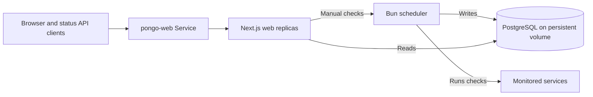

# Pongo project and pipeline guide

Pongo monitors services and turns the check results into an operator dashboard, public status pages, and machine-readable status. This fork uses Pongo for the FOEMI CI/CD assignment. The latest verified release deployed to local K3s is `v1.2.0`. [Hosted release record](evidence/hosted-releases.md)

## How the app works

- **Configuration.** TypeScript files in `pongo/monitors/` define what to check, when to check it, and how to classify the result. Files in `pongo/dashboards/` select which monitors appear on each dashboard. Incident reports and announcements use Markdown.
- **Scheduler.** The Bun scheduler runs checks at their configured intervals and stores results through Drizzle. Its internal HTTP service supports manual checks from the operator dashboard.
- **Web.** Next.js serves the operator dashboard, public status pages, RSS and Atom feeds, and JSON endpoints. On deployed instances the operator dashboard uses a configured access code. The bundled public page is `/shared/status`.
- **Database.** Local development can use SQLite. The two Kubernetes web replicas and one scheduler share PostgreSQL. PostgreSQL stores data on a persistent volume so a web or scheduler rollout can use the existing check history.

### What the endpoints tell you

`/health` confirms that the web process responds. `/ready` checks the database and determines whether a web Pod may receive Service traffic. `/version` reports the version baked in from `release.json` and the build commit. Compare it with the merge SHA, since CI builds the merged commit.

`/api/status.json` reports system status. `/shared/status/status.json` reports the public dashboard status. `/shared/status/availability.json` reports measured availability and check counts for active public monitors over the last 24 hours. Successful checks receive full credit and degraded checks receive half credit. Pending checks are excluded, and a monitor with no measured results reports `null` availability.

## What happens from a branch to a running release

1. **Validate the change.** A PR into `main` or `develop` triggers `CI`, as does a push to either branch. The quality job runs Biome, TypeScript, and Bun unit tests. The browser job runs Playwright with Chromium. Both must pass before the image job starts.
2. **Build and scan.** GitHub's Linux ARM64 runner builds the Docker image with the source SHA and any configured public URL. Trivy scans the runtime image for high and critical vulnerabilities. Findings at those severities fail the job.
3. **Decide whether to release.** The main-branch push qualifies only if `release.json` changes and GitHub identifies the commit as the result of a merged PR into `main`. A docs-only merge with the same version stops after validation.
4. **Publish the scanned image.** The publish job loads the image artifact from the scan job. It pushes a commit-specific tag and the requested release tag to GHCR, refuses to overwrite an existing release tag, and passes the immutable digest to the deployment job.
5. **Ask the target to deploy.** GitHub Actions queues a `foemi-local` deployment containing the release, commit, digest, and workflow run ID. The watcher polls GitHub outbound and checks that the request came from the active main-branch workflow for that commit. It loads the Kubernetes manifests from the exact source commit.
6. **Migrate, roll out, and verify.** The watcher uses a scoped Kubernetes service account. A one-off migration Job applies pending PostgreSQL migrations. The web Deployment rolls to two ready replicas, and the scheduler replaces its single replica to avoid overlapping checks. The watcher checks the applied digests, then port-forwards the web Service to verify `/health`, `/ready`, `/version`, and `/api/status.json`. It reports success or failure to GitHub.

The [workflow](../.github/workflows/ci.yml) defines the hosted jobs. The [deployment runbook](foemi-deployment.md) sets up the cluster, credentials, and watcher. The [watcher](../scripts/watch-local-deployments.sh) and [deployment script](../scripts/deploy.sh) handle the target-side work.

## How we reached the current state

| Step | Change and result |
| --- | --- |
| Baseline audit | Reproduced a build that invoked a database migration and a Next.js version that caused the production build and browser run to fail. The inherited workflow lacked image scanning, publishing, and deployment. [Baseline audit](baseline-audit.md) |
| Build baseline | Updated the pinned Next.js patch and made database migrations explicit. The production build could run without a configured database. [PR #2](https://github.com/gitongatonny/pongo-monitoring/pull/2) |
| `v1.0.0` | Added liveness, readiness, and release metadata. Built a non-root runtime image, pinned a runtime that passed the local Trivy gate, and validated migration, rollout, and rollback on ARM64 K3s. Hosted CI later published and deployed the release. [PR #3](https://github.com/gitongatonny/pongo-monitoring/pull/3), [local rehearsal](evidence/local-rehearsal.md) |
| `v1.1.0` | Added public 24-hour availability with measured check counts and defined how degraded, pending, and missing results contribute. [PR #4](https://github.com/gitongatonny/pongo-monitoring/pull/4) |
| `v1.2.0` | Added a browser test that caught incorrect public links in the status APIs. The failed run skipped image, publish, and deploy. Both routes were corrected, the hosted PR went green, and the main release deployed successfully. [PR #5](https://github.com/gitongatonny/pongo-monitoring/pull/5), [failure and recovery](evidence/ci-failure.md) |

The hosted release record links each merged PR to the corresponding CI, Trivy, and deployment jobs. It also records the published digest and source commit for each version. [Hosted release record](evidence/hosted-releases.md)

## Deploying to a subdomain

The verified cluster serves Pongo locally. The public deployment needs the chosen hostname, access to its DNS zone, and an always-on host or cluster. The current image build targets Linux ARM64. If the hosting target is x86-64, adapt and verify the image build and scan for that architecture before deploying there.

1. **Choose the target.** For the existing pipeline, run K3s and the watcher on an always-on ARM64 machine, with the Kubernetes API bound to loopback. Follow the [deployment runbook](foemi-deployment.md) to provision PostgreSQL, secrets, and GHCR access. If this replaces the local target, take and verify a PostgreSQL backup and restore it if historical checks need to carry over. Give the new host exclusive ownership of the `foemi-local` watcher before the next release.
2. **Configure HTTPS and DNS.** Route the chosen hostname to the web Service, `pongo-web:80` in the `pongo` namespace. Use the DNS record type and target provided by the ingress, reverse proxy, or tunnel. Terminate TLS at that endpoint and preserve the public host and HTTPS scheme when proxying. Keep the scheduler, PostgreSQL, and Kubernetes API on private addresses.
3. **Set the public origin.** Set `PONGO_PUBLIC_URL` in the repository's GitHub Actions variables to the final HTTPS origin, for example `https://status.example.com`. The Docker build receives it as `NEXT_PUBLIC_URL`. Merge a PR with an unused release version to publish a new image with that origin.
4. **Verify as a visitor and operator.** From outside the hosting network, load the public dashboard over HTTPS and check both status APIs' `page.url` fields. Confirm `/health`, `/ready`, and `/version`, sign in to the operator dashboard, and verify that fresh check results arrive. Record the public URL, version, and digest after verification.

The [live assessment guide](live-assessment-guide.md) uses the verified local target and includes an optional public HTTPS check if the subdomain is ready by then.
